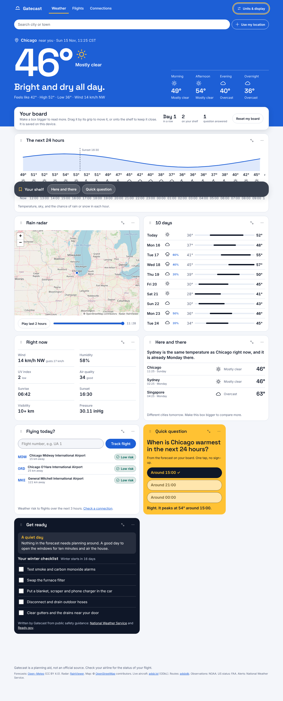

# Gatecast

[](https://github.com/VictorParker22/gatecast/actions/workflows/ci.yml)

Gatecast tells you, in one plain sentence, whether the weather is likely to disrupt your flight or connection. Enter your airports, departure time and layover, and it lines up the forecast at every stop with the hours you are actually there, rates each airport Low, Elevated or High, and says why. Around that sits a local weather home page and live flight status. It is a static site with no framework, built on free, keyless data sources, with a small server only for the sources that cannot be called from a browser.

<p align="center">
  
</p>

More screenshots, including the connection checker, are in [`docs/screenshots/`](docs/screenshots/).

## Contents

- [What it does](#what-it-does)
- [Quick start](#quick-start)
- [Tests](#tests)
- [Deployment](#deployment)
- [Project structure](#project-structure)
- [Data sources and limits](#data-sources-and-limits)
- [The risk level](#the-risk-level)
- [Design direction](#design-direction)
- [Contributing](#contributing)
- [Security](#security)
- [License](#license)

## What it does

Local weather with flight status. Three pages:

- **Today** (`index.html`): the animated sky with one answer on top. If one of your saved trips leaves within 72 hours, its verdict leads; otherwise the weather where you are does, and a first visit gets a short welcome with location and city search. Below: what today's weather means for you (commute, what to take, air and sun, flights near you), the next 10 days and the rain radar.
- **Trips** (`trip.html`): enter your airports, departure time and layover and get a plain-language verdict on whether weather threatens the connection.
- **Flights** (`flights.html`): track a flight live by number, with weather at both ends, or look up any airport's current weather risk and the aircraft around it.

## Quick start

```bash
node server.js     # or: npm run dev
```

Then open http://localhost:4173. Node 18 or newer, no dependencies, no build step. Set `PORT` to use another port.

The weather page and connection checker also work as plain static files. Flight tracking, "Right now" airport observations and FAA delay programmes need the `/api` routes (`server.js` locally, the `api/` functions on Vercel), because those sources do not allow direct browser calls.

## Tests

```bash
node --test tests/*.mjs tests/*.cjs     # or: npm test
```

CI runs the tests and the build step on Node 18.x and 22.x for every push and pull request (`.github/workflows/ci.yml`). To run the same thing locally:

```bash
npm ci
npm run ci          # npm test && npm run build
```

## Deployment

The site is deployed on Vercel (`vercel.json`). Vercel runs `node scripts/build-data.cjs`, which downloads the airport list, writes the map outline, and assembles the static site in `public/`; the functions in `api/` serve the `/api` routes. The build step needs `npm ci` first (for `topojson-client` and `world-atlas`) and network access. `public/` is generated and not committed.

## Project structure

| Path | What it does |
|---|---|
| `index.html`, `js/weather.js`, `styles/home.css` | Today: sky hero (trip verdict, weather or first visit), "here now" card, what today means, 10 days, radar |
| `js/today.js` | Today's pure logic: upcoming trip, commute, what to take, air and sun, flights near you (unit-tested) |
| `js/sky.js`, `js/sky/shaders.js`, `styles/sky.css` | WebGL animated sky behind the header, with a flat-colour fallback |
| `js/sky/governor.js` | Decides the sky's quality level from measured frame times (pure, unit-tested) |
| `js/motion.js`, `styles/motion.css` | First-load entrance and small press feedback, off under reduced motion |
| `js/boardcontent.js` | Headline sentence and sky mapping used by Today; also older content helpers kept for their tests (pure, unit-tested) |
| `js/journey.js`, `js/tripview.js`, `styles/trip.css` | Trips: the journey strip model (pure, unit-tested) and the verdict, strip and stop-card views |
| `js/flightstatus.js`, `styles/flights.css` | Flights: which number leads, position freshness, the one-line weather verdict (pure, unit-tested) |
| `flights.html`, `js/flights.js` | Flight tracking and airport view |
| `trip.html`, `js/trip.js` | Connection checker |
| `js/shell.js` | Shared storage; unit, clock (12 or 24 hour) and theme preferences; settings popover |
| `js/core.js` | Time zones, flight-time estimates, risk scoring, trip verdict (pure, unit-tested) |
| `js/data.js` | Airport and city search, forecasts, alerts, flight and live-data clients |
| `js/ui.js` | Icons, units and chips shared by every page |
| `js/view.js` | Route map and hourly strip for the flights and connections pages (re-exports `js/ui.js`) |
| `styles/tokens.css`, `styles/app.css` | Design tokens and components |
| `lib/live.js` | Server-side lookups: airport observations, FAA status, flight route and position, nearby aircraft |
| `api/*.js` | Vercel functions wrapping `lib/live.js` |
| `server.js` | Local static server exposing the same `/api` routes |
| `scripts/build-data.cjs` | Build step: airport list with size ranking, map outline, assembles `public/` |
| `vendor/leaflet/` | Leaflet 1.9.4 (BSD-2-Clause), used only for the radar map |
| `vendor/fonts/` | Inter and Barlow Condensed (SIL Open Font License), self-hosted |
| `data/airports.json` | 7,769 airports with IATA codes, time zones and a size rank |
| `js/config.js` | The Supabase project address and its publishable key (public by design; row rules decide access) |
| `js/civic.js`, `js/civicmodel.js`, `styles/civic.css` | "Your statehouse" and "Both sides" on Today: mounted with `mountCivic(root, { state })`; the words and numbers are pure and unit-tested |
| `review.html`, `js/review.js`, `js/reviewmodel.js`, `styles/review.css` | Reviewer console for the Both sides queue (sign-in link, queue, publish, assistant); not in the navigation, `noindex`. Rules in `reviewmodel.js` are unit-tested |
| `supabase/migrations/` | Database: the Both sides review queue, statehouse votes and their switch, the hourly collector job; see `supabase/README.md` |
| `supabase/functions/` | Edge Functions: `collect` (statehouse votes from Open States, hourly) and `assist` (the reviewer console's assistant) |
| `docs/` | Design system, user research plan, research report, content sources, moderation policy, design direction |
| `tests/` | Unit tests for the pure modules and the server's parsers (`node --test`) |
| `.github/` | CI workflow, Dependabot, issue forms and pull request template |

## Data sources and limits

- **Forecast:** Open-Meteo, called from the visitor's browser, up to 16 days ahead. The free tier is for non-commercial use and is limited per network address; a commercial launch needs their paid plan. Attribution (CC BY 4.0) is in the page.
- **US alerts:** api.weather.gov, from the browser.
- **Airport observations:** NOAA Aviation Weather Center METAR, through `server.js`.
- **US airport delay programmes:** FAA NAS Status, through `server.js`.
- **Flight tracking:** route (origin and destination) from adsbdb and live position from adsb.lol, both keyless, through `/api/flight`. There is no free source of scheduled times, gates, delays or cancellations, so those are not shown, and the landing time is an estimate from distance and speed.
- **City search and air quality:** Open-Meteo geocoding and air-quality services, from the browser.
- **Radar:** RainViewer past-radar tiles (free for personal and small-scale use) over OpenStreetMap tiles, loaded only when the radar panel scrolls into view.
- **Location:** the browser's geolocation, requested only after the visitor presses "Use my location". Coordinates are rounded to about a kilometre, kept in the browser, and sent only to the forecast service. The place name comes from the nearest airport in the bundled list, not from a lookup service.

## The risk level

Each forecast hour is scored for thunderstorms, freezing rain, snowfall rate, fog and visibility, gusts and rain rate (`scoreHour` in `js/core.js`). The worst hour during the visitor's time at an airport sets its level: below 30 is Low, 30 to 59 Elevated, 60 and above High. For a connection, weather where the inbound flight departs counts at half weight, and the layover length adds or removes points. The thresholds are judgement calls, not calibrated against delay records; `docs/user-research.md` lists the back-test that should tune them.

## Design direction

The visual language in use today is documented in [`docs/design-system.md`](docs/design-system.md). The team is exploring a redesign, "a departure board for weather", in which your trip is the home page, one journey sits on one time axis, and colour only ever means risk. The idea, the critique behind it, the screens explored and the open questions before launch are in [`docs/redesign.md`](docs/redesign.md). It is now built: monochrome tokens where colour only means risk, Barlow Condensed signage type, the new header and navigation, and the rebuilt Today, Trips and Flights pages.

## Contributing

Contributions are welcome. [`CONTRIBUTING.md`](CONTRIBUTING.md) covers setup, tests, branch and commit conventions, the design principles and the content and honesty rules. Please use the issue forms for bugs and ideas, and follow the [Code of Conduct](CODE_OF_CONDUCT.md). Notable changes are listed in [`CHANGELOG.md`](CHANGELOG.md).

## Security

Please report security problems privately, not in public issues. See [`SECURITY.md`](SECURITY.md).

## License

Gatecast has no licence yet. Until the owner chooses one, the code is not offered under an open-source licence, and all rights are reserved by its authors.

The vendored third-party files in `vendor/` keep their own licences: Leaflet 1.9.4 under BSD-2-Clause (`vendor/leaflet/LICENSE`), and the Inter and Barlow Condensed fonts under the SIL Open Font License (`vendor/fonts/LICENSE-Inter.txt`, `vendor/fonts/LICENSE-BarlowCondensed.txt`). Data sources carry their own terms, listed under [Data sources and limits](#data-sources-and-limits).
